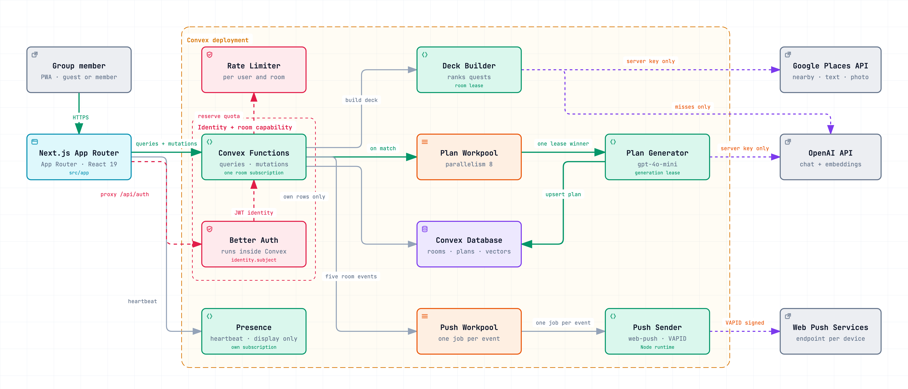

# Questly

Questly helps a group pick an activity and agree on a plan. One person opens a room, everyone else joins with a four-digit code, and the group swipes through a deck of nearby places until enough people land on the same one. A match turns into a written plan, a proposal, and finally a booking.

Guests never need an account. They carry a session key and a seat in the room, not an identity.

## Architecture



The whole backend is one Convex deployment. Next.js renders and proxies auth, but holds no secret of its own: Better Auth runs inside Convex, and the Google and OpenAI keys never leave the deployment.

Two paths carry most of the work. A match enqueues exactly one plan generation through a workpool, and the generator writes the plan back under a lease so a duplicate job cannot produce a second plan. Room events enqueue a push job through a second workpool, and one Node action signs and delivers them to each browser's push service.

Every room screen runs on a single reactive query. It reads the caller's own swipes rather than the whole room's and takes the rest from a per-member counter, so a recomputation no longer grows with the number of swipes cast. Who is still on the page is a second, separate subscription on the presence component, and it is display-only: it never moves a match threshold. Venue embeddings are stored once per venue and model, so a room that borrows a cached deck spends no OpenAI quota re-deriving them. Schema changes run through the migrations component, which is what backfilled those counters.

The interactive version of the diagram, with per-node sources and guided views, is [design/architecture/questly-architecture.html](design/architecture/questly-architecture.html). There is a companion diagram of the [taste-embedding flow](design/architecture/questly-embeddings.html).

## Stack

Next.js 16 App Router with React 19 and Tailwind v4 on the front. Convex for data, functions, and scheduling, with the Better Auth, rate limiter, workpool, migrations, and presence components mounted alongside it. Google Places for candidates, OpenAI for plan text and taste embeddings, and web-push with VAPID for notifications.

## Getting started

```bash
npm ci
npx convex dev     # deployment watcher, not just a local server
npm run dev
```

Copy `.env.example` to `.env.local` and fill it in. Only public values belong there. Secrets go into the Convex deployment with `npx convex env set <NAME> <value>`, and `.env.example` lists which ones and where each comes from. Read [the setup guide](.docs/setup.md) before the first run.

| Script | Does |
| --- | --- |
| `npm run dev` | Next.js dev server |
| `npm run build` | Production build |
| `npm test` | Vitest, once |
| `npm run lint` | ESLint |

## Documentation

The [project handbook](.docs/index.md) is the source of truth:

- [Setup and verification](.docs/setup.md)
- [Infrastructure](.docs/infrastructure.md), for boundaries, quotas, and queues
- [Coding conventions](.docs/coding-conventions.md)
- [Required task workflow](.docs/task-workflow.md), for small and large changes

Agents read [AGENTS.md](AGENTS.md) first. Claude's [CLAUDE.md](CLAUDE.md) imports the same root instructions.
